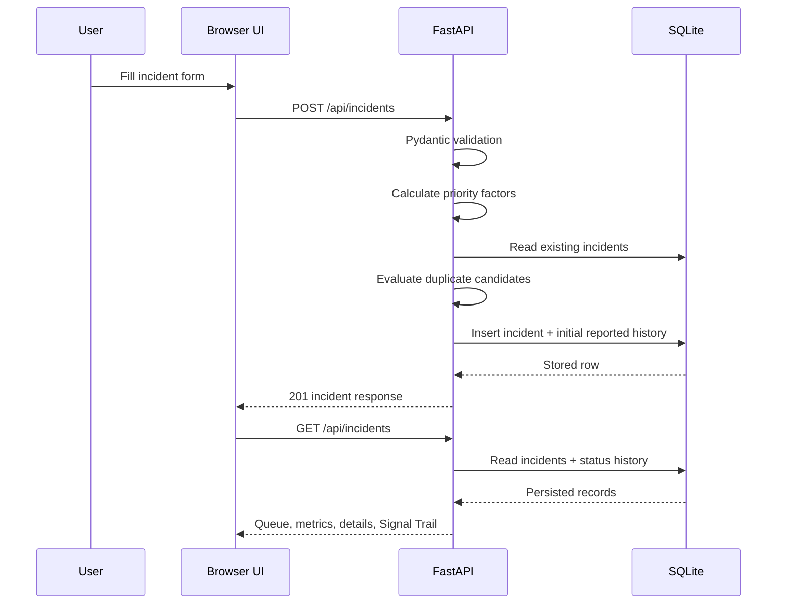
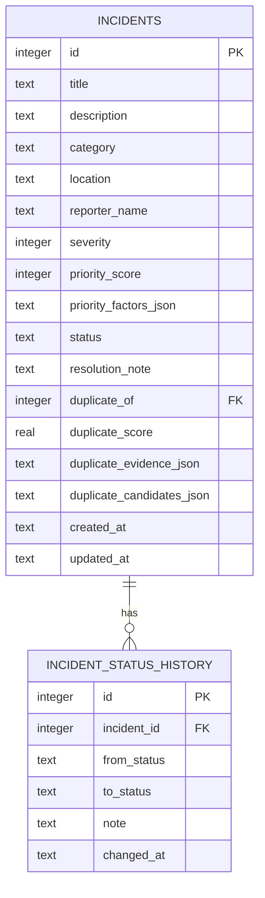
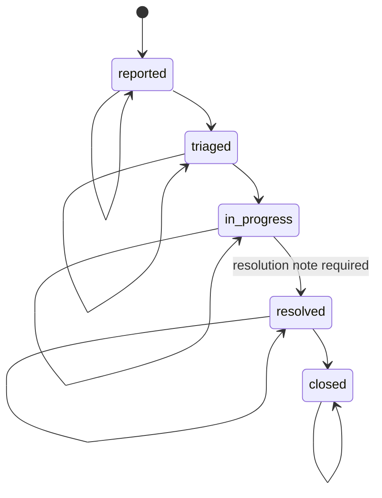

# CampusSignal architecture

CampusSignal is a small, self-contained incident-management application. A browser client submits and reviews incidents through a FastAPI application. The application validates input, calculates transparent priority factors, evaluates duplicate candidates, and stores the original report plus workflow history in SQLite.

## System architecture

```mermaid
flowchart LR
    Browser[Browser UI<br/>HTML · CSS · JavaScript]
    API[FastAPI application<br/>routes + Pydantic validation]
    Intelligence[Incident intelligence<br/>priority_for + duplicate_match]
    SQLite[(SQLite database<br/>incidents + status history)]

    Browser -->|GET /, /static/*| API
    Browser -->|GET /api/incidents| API
    Browser -->|POST /api/incidents| API
    Browser -->|PATCH /api/incidents/{id}| API
    API --> Intelligence
    API --> SQLite
    Intelligence --> API
```

There are no external AI APIs, queues, hosted databases, authentication services, or background workers in the current implementation.

## Request and data flow



The frontend refreshes the full incident collection after a successful report or status update. Metrics are derived from that returned collection: active means not `resolved` or `closed`; high priority means score `>= 70`; resolved means `resolved` or `closed`.

## Frontend

- `app/static/index.html` defines the application shell, report form, queue, detail panel, filters, and accessible status regions.
- `app/static/styles.css` contains the visual system, responsive layouts, focus states, motion, and reduced-motion rules.
- `app/static/app.js` owns API calls, queue filtering, DOM rendering, status controls, loading/error states, and safe rendering with `textContent` and explicit DOM construction.

The browser does not contain mock incident records. It renders only API responses and calculated views of those responses.

## Backend routes

| Method | Path | Responsibility |
| --- | --- | --- |
| `GET` | `/` | Serves the browser application. |
| `GET` | `/static/*` | Serves frontend assets. |
| `GET` | `/health` | Returns `{ "status": "ok" }`. |
| `GET` | `/api/incidents` | Returns incidents newest-first, including priority factors, duplicate candidates, and status history. |
| `POST` | `/api/incidents` | Validates and stores a report, calculates priority, evaluates existing reports, and creates initial `reported` history. |
| `PATCH` | `/api/incidents/{incident_id}` | Applies a valid lifecycle transition and records status-history evidence. |

FastAPI also exposes generated interactive API documentation at `/docs` and an OpenAPI schema at `/openapi.json`.

### Validation and errors

`IncidentCreate` validates title, description, location, reporter name, category, and severity. Invalid payloads return FastAPI/Pydantic `422` responses. `IncidentUpdate` validates statuses and resolution-note length. Missing incidents return `404`; invalid lifecycle transitions and resolution without a note return `422`.

Database writes use the `get_connection()` context manager. Successful operations commit; exceptions roll back and re-raise, preventing partial incident updates.

## Database entities



`incidents` preserves every original report. `duplicate_of` is only a review suggestion; no route merges or deletes reports. JSON fields store the explainable priority and duplicate-analysis results returned to the UI.

## Incident lifecycle



Only the transitions above are accepted. A resolution note is required when entering `resolved`. Status history records the initial `reported` state and each subsequent accepted update, including timestamps and notes.

## Priority scoring

`priority_for()` is deterministic and caps the final score at 100:

- Severity: `12 * severity` points, where severity is 1–5.
- Category baseline: safety 20, wellbeing 15, facilities 10, technology 8, academic 6, other 4.
- Urgency language: up to 15 points, five points per recognized term from the report text (`urgent`, `danger`, `dangerous`, `emergency`, `blocked`, `fire`, `flood`).

The API returns each factor, its points, and a human-readable explanation. These are operational heuristics, not calibrated probabilities.

## Duplicate detection

Each new report is compared with every existing report. The candidate score combines:

- 50% meaningful-word Jaccard text overlap after case/whitespace normalization.
- 20% same category.
- 20% same normalized location.
- 10% reported within the last 24 hours.

Candidates include the incident ID, score, matching signals, conflicting signals, and a human-review explanation. A score of `0.65` or higher populates `duplicate_of`; it does not change lifecycle state, merge rows, or delete originals.

## Configuration and deployment assumptions

`DATABASE_PATH` controls the SQLite file and defaults to `data/campussignal.db` locally. The Docker image sets it to `/app/data/campussignal.db` and expects `/app/data` to be writable by the unprivileged `campussignal` user (UID 10001). The image exposes port 8000 and starts Uvicorn with `app.main:app`.

The service is intended for a trusted development or small operational deployment. It is single-process SQLite and does not yet include authentication, authorization, HTTPS termination, backups, rate limiting, external logging, or multi-worker coordination.
